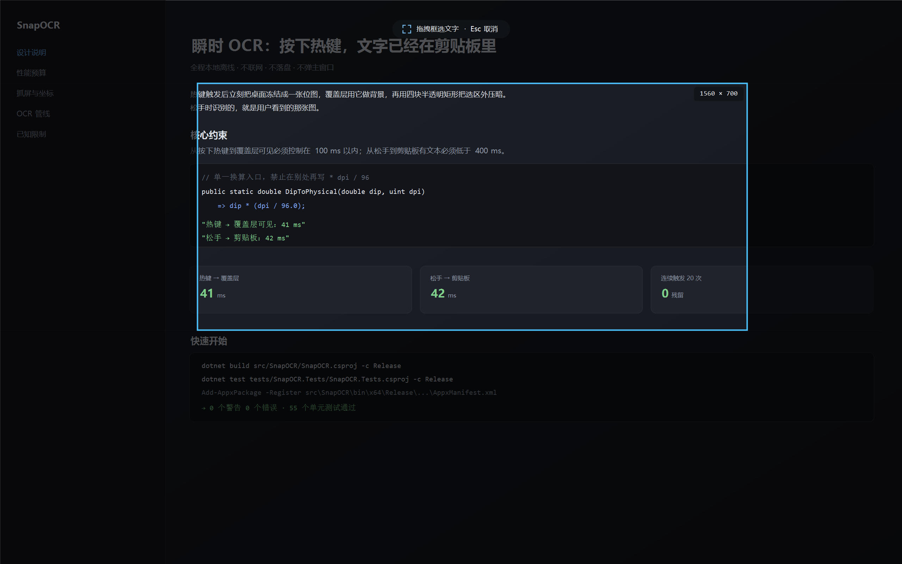
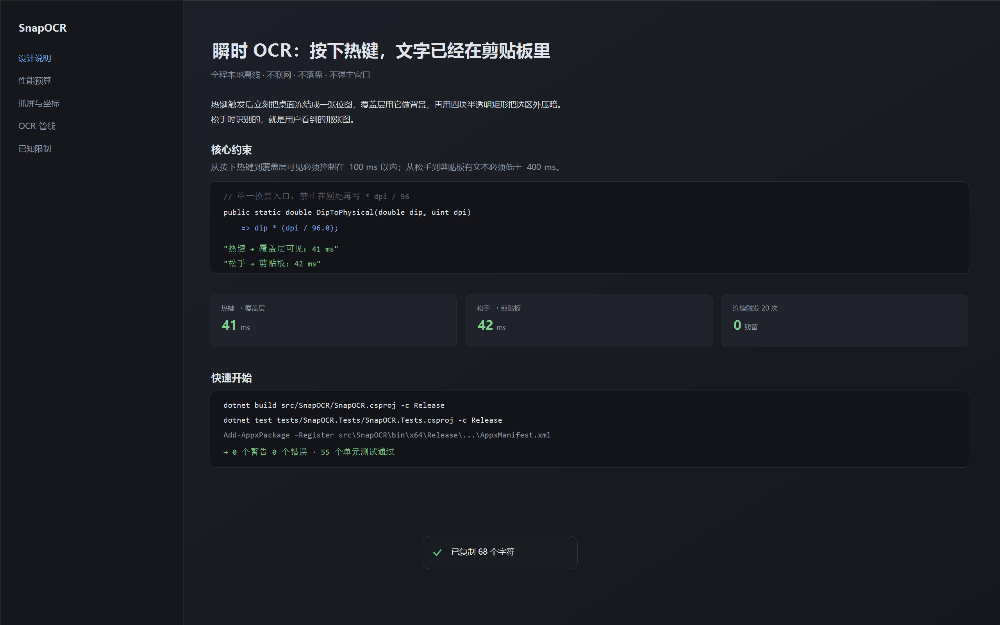

# SnapOCR

**按下热键，框一下，文字已经在剪贴板里。**

[](https://github.com/K3589/SnapOCR/actions/workflows/build.yml)
[](LICENSE)

一个常驻托盘的 Windows 11 瞬时 OCR 小工具。没有主窗口，不联网，不上传任何像素 —— 识别用的是系统自带的本地引擎。



<sub>界面效果图：屏幕冻结后整体压暗，拖出选区即时显示像素尺寸，松手立刻识别。</sub>

---

## 它解决什么问题

你在屏幕或截图里看到一段文字，想复制出来。常规做法是：截图 → 打开某个工具 → 上传 → 等识别 → 复制。中间还要担心这段话会不会被打包发到别人服务器上。

SnapOCR 把这件事压缩成一次拖拽：

1. 按 `Win + Shift + T`（被占用时自动降级到 `Ctrl + Shift + T`）
2. 拖一个框
3. 松手，`Ctrl + V` 已经能粘贴了

屏幕会闪一下变暗，松手后底部弹一个约 1 秒的提示 —— 就这些，没有别的窗口跳出来。



## 特性

- **快**：热键到覆盖层可见 **41 ms**，松手到剪贴板 **42 ms**（2560×1600 @150%，实测）
- **离线**：`Windows.Media.Ocr` 本地引擎，断网可用，不产生任何网络请求
- **不落盘**：内存里处理完就丢，Release 构建零文件写入
- **原生**：C# + WinUI 3 / Windows App SDK，Mica/Acrylic、圆角、Segoe Fluent 图标，深浅色与 DPI 自动跟随
- **多屏**：每块显示器一个覆盖层，负坐标与不同缩放比例都按物理像素对齐
- **单实例**：重复启动只会唤起已有进程，不会多开
- **中文友好**：内置引擎对中文是逐字吐空格的（`公 民 身 份 证 号 码`），这里做了空格折叠，粘贴出来是正常句子
- **可替换后端**：OCR 走 `IOcrService` 接口，想换 RapidOCR / PaddleOCR ONNX 只需再写一个实现
- **跟随系统截图**（可选）：打开后按 `Win + Shift + S` 截完图，文字自动进剪贴板

## 环境要求

| 项目 | 版本 |
| --- | --- |
| 操作系统 | Windows 11（最低 Windows 10 19041） |
| .NET SDK | **10.0.403** |
| Windows SDK | **10.0.26100.0** |
| Windows App SDK | **2.7.0**（含 Windows App Runtime 2.7.0） |
| OCR 语言包 | 中文需 `zh-Hans-CN`，英文需 `en-US` |

> 版本号是在开发机上实测得到的，统一写在 `Directory.Build.props`。换环境请先确认 `dotnet --info` 与 `Get-AppxPackage Microsoft.WindowsAppRuntime*`。

### 缺中文 OCR 语言包怎么办

先检测：

```powershell
$t = [Windows.Media.Ocr.OcrEngine, Windows.Foundation, ContentType=WindowsRuntime]
$t::AvailableRecognizerLanguages | ForEach-Object { $_.LanguageTag + " | " + $_.DisplayName }
```

输出里没有 `zh-` 开头就需要装（**管理员** PowerShell）：

```powershell
Add-WindowsCapability -Online -Name Language.OCR~~~zh-CN~0.0.1.0
```

装完不用重启应用，在设置里保存一次即可重新创建引擎。

## 从源码运行

```powershell
git clone https://github.com/K3589/SnapOCR.git
cd SnapOCR

dotnet build src/SnapOCR/SnapOCR.csproj -c Release

# 注册成开发包（当前用户，无需证书）
Add-AppxPackage -Register "src\SnapOCR\bin\x64\Release\net10.0-windows10.0.26100.0\AppxManifest.xml"

# 启动
$pfn = (Get-AppxPackage -Name SnapOCR).PackageFamilyName
Start-Process "shell:AppsFolder\$pfn!App"
```

托盘出现图标即可用。改完代码重新 `dotnet build` 后再执行一次 `Add-AppxPackage -Register` 就生效（先杀掉旧进程，否则 exe 被占用会构建失败）。

卸载：

```powershell
Get-AppxPackage -Name SnapOCR | Remove-AppxPackage
```

> 这是 MSIX 打包应用，**不要**直接双击 `SnapOCR.exe` —— 脱离包标识会启动失败。

## 打包成 MSIX 分发

```powershell
dotnet publish src/SnapOCR/SnapOCR.csproj -c Release `
  -p:Platform=x64 `
  -p:GenerateAppxPackageOnBuild=true `
  -p:AppxPackageSigningEnabled=false `
  -p:AppxBundle=Never `
  -p:UapAppxPackageBuildMode=SideloadOnly
```

产物：`src\SnapOCR\AppPackages\SnapOCR_1.0.0.0_x64_Test\SnapOCR_1.0.0.0_x64.msix`（实测 64.7 MB）。

产出的包**未签名**，正式分发需要用证书签：

```powershell
# 自签（仅本机测试用）
$cert = New-SelfSignedCertificate -Type Custom -Subject "CN=SnapOCR" `
  -KeyUsage DigitalSignature -FriendlyName "SnapOCR Dev" `
  -CertStoreLocation "Cert:\CurrentUser\My" `
  -TextExtension @("2.5.29.37={text}1.3.6.1.5.5.7.3.3", "2.5.29.19={text}")

Export-Certificate -Cert $cert -FilePath SnapOCR.cer
Import-Certificate -FilePath SnapOCR.cer -CertStoreLocation Cert:\LocalMachine\TrustedPeople

& "${env:ProgramFiles(x86)}\Windows Kits\10\bin\10.0.26100.0\x64\signtool.exe" `
  sign /fd SHA256 /a /f SnapOCR.pfx /p <密码> `
  src\SnapOCR\AppPackages\SnapOCR_1.0.0.0_x64_Test\SnapOCR_1.0.0.0_x64.msix
```

构建日志里有一条 `mspdbcmf.exe could not be found` 的警告，只影响符号包生成，可以忽略。

## 使用

| 操作 | 效果 |
| --- | --- |
| `Win + Shift + T` | 默认热键，进入框选 |
| `Ctrl + Shift + T` | Win 组合被占用时的自动降级热键 |
| 拖拽 | 框选，实时显示像素尺寸 |
| `Esc` / 右键 | 取消本次框选 |
| 双击托盘图标 | 立即识别 |
| 右键托盘图标 | 立即识别 / 设置 / 开机自启 / 退出 |

设置页只有 6 项：全局热键（点一下直接按新组合键录制）、OCR 语言、自动复制、结果提示、开机自启、跟随系统截图。

配置文件位置（MSIX 会把 `%LOCALAPPDATA%` 重定向到包容器）：

```
%LOCALAPPDATA%\Packages\SnapOCR_<PublisherHash>\LocalCache\Local\SnapOCR\settings.json
```

热键被占用时可以在设置里换一个（必须带 Ctrl/Alt/Shift/Win 至少一个修饰键）。查某个组合是否空闲：

```powershell
Add-Type @"
using System;
using System.Runtime.InteropServices;
public class HK {
  [DllImport("user32.dll", SetLastError=true)] public static extern bool RegisterHotKey(IntPtr h, int id, uint m, uint k);
  [DllImport("user32.dll", SetLastError=true)] public static extern bool UnregisterHotKey(IntPtr h, int id);
}
"@
[HK]::RegisterHotKey([IntPtr]::Zero, 1, 0x400C, 0x54)   # Win+Shift+T，0x4000 = MOD_NOREPEAT
[HK]::UnregisterHotKey([IntPtr]::Zero, 1)
```

返回 `False` 就是被占了。

## 实测性能

环境：Windows 11 25H2 / 2560×1600 @150% / 单显示器。

| 指标 | 目标 | 实测 |
| --- | --- | --- |
| 热键 → 覆盖层可见 | < 100 ms | **41–62 ms**（抓屏 26–30 ms） |
| 松手 → 剪贴板有文本 | < 400 ms | **42–132 ms** |
| 连续触发 20 次 | 无窗口残留 / 内存不增长 | 顶层窗口恒为 3 个；内存 213→231 MB 后走平；20 次全部写入成功 |
| 断网可用 | 必须 | 全部本地 API，无网络调用 |
| 进程写图片 | 0 次 | Release 构建不写任何文件 |

## 它是怎么做的

三句话讲完：

1. 热键触发后，用 GDI `BitBlt` 把所有屏幕抓成内存位图（不用 `Windows.Graphics.Capture`，那会弹系统选择器）。
2. 每块显示器一个预创建的无边框置顶窗口，把冻结帧铺满，再用四块半透明矩形把选区外压暗。
3. 松手时从内存位图裁出选区 → 构造 `SoftwareBitmap` → `Windows.Media.Ocr` 识别 → 写剪贴板。

设计取舍、踩过的坑、坐标换算细节都在 **[docs/DESIGN.md](docs/DESIGN.md)**，包括：

- 为什么 Windows App SDK 2.7 上没有「透明窗口」这条路
- 为什么抓屏必须赶在覆盖层显示之前
- 窗口 DPI ≠ 显示器 DPI 时会怎样
- 16 MB 的整屏缓冲如何避免把内存顶上去
- `startupTask` 清单为什么必须用 `desktop:` 命名空间

## 已知限制

- 内置 OCR 对小字（<12px）、艺术字、竖排、手写体识别率有限。选区高度低于 200px 会自动放大 2 倍再识别，但救不了模糊源。
- 形近字会错（实测把「窗口」认成「窗囗」）。
- 跨屏框选只取相交面积最大的那块屏裁剪，不拼接两屏。
- 覆盖层按鼠标左键判定，触屏需要额外适配。
- 默认热键 `Win+Shift+T` 在部分机器上已被占用，会自动降级并在托盘提示。

## 项目结构

```
src/SnapOCR/
  Program.cs              单实例入口
  App.xaml(.cs)           生命周期、托盘/热键接线、流程编排
  MainWindow.xaml(.cs)    仅作消息宿主，永不显示
  Interop/                P/Invoke、热键、托盘、剪贴板、DIB 读取
  Capture/                BitBlt 抓屏、显示器枚举、DIP↔物理像素换算
  Ocr/                    IOcrService、Windows.Media.Ocr 实现、文本拼接
  UI/                     覆盖层窗口、多屏管理、结果 Toast
  Settings/               设置模型、JSON 存储、热键解析、设置页
tests/SnapOCR.Tests/      55 个单元测试（DPI 换算 / 文本拼接 / 热键解析）
tools/                    诊断工具（抓屏+OCR 探针、端到端验收探针、图标生成）
```

测试与诊断：

```powershell
dotnet test tests/SnapOCR.Tests/SnapOCR.Tests.csproj -c Release

# 抓屏 + OCR 探针：不开 UI，直接输出识别结果与耗时
dotnet run --project tools/OcrProbe -- .\shots

# 端到端验收：模拟热键 + 拖拽 + 读剪贴板；--stress 20 是压测
dotnet run --project tools/UiProbe -- --stress 20
```

## 许可

[MIT](LICENSE) © 2026 K3589
